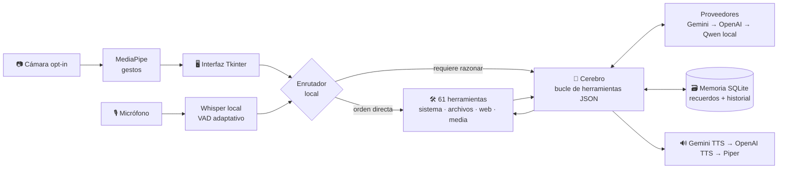

<div align="center">

# 🐺 BARK

### Asistente de IA personal para Windows: voz, memoria y control real del equipo. Local primero, privado por diseño.


</div>

---

Dices **«Bark, abre Spotify y pon algo de Daft Punk»** y Bark lo hace. Dices **«mi pc va lenta»** y la diagnostica, libera RAM, limpia temporales y te explica qué la está frenando. Si se va el internet, **sigue funcionando**: el cerebro, el oído y la voz corren en tu propia máquina.

Bark no es un chatbot con micrófono. Es un **agente**: entiende lo que pides, elige entre **61 herramientas reales** del sistema operativo, las ejecuta, pide permiso antes de lo delicado y recuerda lo que le contaste entre sesiones.

## ✨ Lo que lo hace diferente

| | |
|---|---|
| 🧠 **Siempre responde** | Cadena de proveedores resiliente: **Gemini → OpenAI → Qwen local**. Si una API falla, se queda sin saldo o no hay red, pasa a la siguiente sin que lo notes. Con `BARK_PROVEEDOR=local` funciona 100 % offline. |
| 🎙️ **Voz natural y rápida** | Whisper local con umbral de ruido adaptativo y palabra de activación. La voz Piper habla **por frases en streaming**: empieza a hablar mientras sintetiza la siguiente, pronuncia cifras en español y no lee markdown, emojis ni rutas. |
| ⚡ **Respuesta instantánea** | Las órdenes comunes (volumen, apps, temporizadores, batería…) se resuelven con un enrutador local **sin pasar por el LLM**. Solo lo que necesita razonar llega al modelo. |
| 🔒 **Privado por diseño** | Memoria en SQLite local con respaldos automáticos. Los recuerdos marcados como **sensibles nunca entran a un prompt de nube**. La cámara es opt-in y ningún fotograma sale del equipo. |
| 🛡️ **Seguro** | Apagar, borrar o desactivar programas de inicio **siempre pide confirmación** (por voz o en pantalla). La edición de código usa reemplazos exactos y verifica la sintaxis después. |
| 🖐️ **Control por gestos** | Con MediaPipe: **palma abierta = activar voz, puño = suspender**. Todo procesado localmente. |

## 🛠️ Qué puede hacer

<table>
<tr><td width="50%" valign="top">

**🖥️ Control del equipo**
- Abrir apps por nombre hablado, incluidas apps de la Tienda sin acceso directo, con *fuzzy matching* para errores de dictado («spotifi»)
- Volumen, brillo, bloqueo, suspensión, apagado programado
- Listar y enfocar ventanas, portapapeles, ajustes de Windows
- Temporizadores y recordatorios con aviso

**🚀 Optimización del PC**
- Diagnóstico de RAM por proceso y liberación sin cerrar apps
- Limpieza de temporales, caché DNS y planes de energía
- Revisión de programas de inicio (registro, carpetas y tareas)

</td><td width="50%" valign="top">

**📄 Archivos y documentos**
- Buscar archivos locales por nombre y fecha, abrirlos y convertirlos
- Leer PDF y Word; **investigar un tema y generar un .docx** con formato APA

**🌐 Web y multimedia**
- Búsqueda web y extracción de páginas
- Control de Spotify y búsqueda de canciones
- Descarga de video/audio con `yt-dlp`, capturas de pantalla

**👨‍💻 Modo ingeniero de software**
- Explora un proyecto, lee código, aplica ediciones exactas y verifica la sintaxis de Python

</td></tr>
</table>

## 🏗️ Arquitectura



```
bark/
├── main.py              # punto de entrada: consola, --ui, --voz, --asistente
├── nucleo/
│   ├── cerebro.py       # agente: enrutador, bucle de herramientas, prompts
│   ├── proveedores.py   # cadena resiliente nube → local
│   ├── escuchar.py      # Whisper, palabra de activación, permisos por voz
│   ├── voz_local.py     # Piper en streaming por frases
│   ├── vision.py        # gestos y rostro con MediaPipe (local)
│   ├── bd_manager.py    # memoria y biblioteca en SQLite
│   └── servicio.py      # asistente de voz en segundo plano
├── acciones/
│   ├── comandos.py      # herramientas: archivos, web, documentos, media
│   ├── apps.py          # índice inteligente de apps de Windows
│   └── sistema.py       # volumen, brillo, energía, ventanas, temporizadores
├── interfaz/ui.py       # interfaz translúcida con centro de optimización
├── config/              # configuración, personalidad, .env.example
└── tests/               # 62 pruebas unitarias
```

## 🚀 Instalación

**Requisitos:** Windows 10/11, Python 3.10+, micrófono. GPU opcional.

```bash
git clone https://github.com/mesudadedillo-jpg/BARK.git
cd BARK
python -m venv venv
venv\Scripts\activate
pip install -r requirements.txt
python descargar_modelo.py          # LLM local (~2.5 GB)
copy config\.env.example .env       # claves de API opcionales
```

Las voces y los modelos de visión se colocan en `modelos/` ([ver guía](modelos/README.md)). Luego:

```bash
Iniciar_Bark.bat        # interfaz gráfica
python main.py --voz    # solo voz
python main.py          # consola
```

La palabra de activación es **«Bark»**.

## ⚙️ Configuración

Todo se ajusta en `.env`, sin tocar código. Lo principal:

| Variable | Qué hace |
|---|---|
| `BARK_PROVEEDOR` | `auto`, `gemini`, `openai` o `local` (100 % offline) |
| `BARK_VOZ` | `auto`, `gemini`, `openai` o `local` (Piper) |
| `BARK_MODELO_LLM` | Fuerza un `.gguf` concreto de `modelos/` |
| `BARK_GPU_LAYERS` | `-1` para usar GPU con llama-cpp-python |
| `BARK_MODELO_WHISPER` | `base` (rápido) o `small` (más preciso) |
| `BARK_VOZ_DEBUG` | `1` guarda el último audio recibido para diagnosticar el micrófono |

La guía completa de órdenes y ajustes está en [`docs/GUIA.md`](docs/GUIA.md).

## 🧪 Pruebas

```bash
python -m unittest discover tests
```

62 pruebas cubren el enrutador de órdenes, la detección de recuerdos y datos sensibles, la resolución de apps, la limpieza de texto para voz y la segmentación por frases.

## 🗺️ Roadmap

- [ ] Instalador `.exe` de un clic
- [ ] Nodo en Raspberry Pi y app móvil conectados por WireGuard
- [ ] Memoria semántica con embeddings (pgvector)
- [ ] Automatización del hogar vía MQTT

## 👤 Autor

**Joshua Dylan Caro Lemus** · Fundador de [DigiPyme](https://digipyme.com.mx)
Ingeniería en Tecnologías de la Información e Innovación Digital · Tulancingo, México

¿Te interesa un asistente así para tu negocio? Escríbeme por [digipyme.com.mx](https://digipyme.com.mx).
