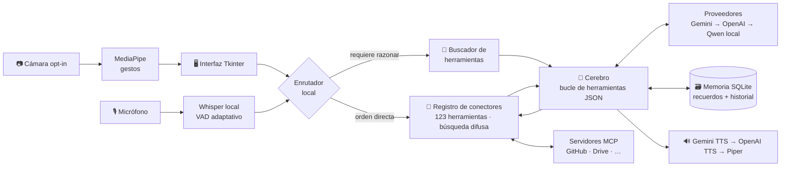

<div align="center">

# 🐺 BARK

### Asistente de IA personal para Windows: voz, memoria y control real del equipo. Local primero, privado por diseño.


</div>

---

Dices **«Bark, abre Spotify y pon algo de Daft Punk»** y Bark lo hace. Dices **«mi pc va lenta»** y la diagnostica, libera RAM, limpia temporales y te explica qué la está frenando. Si se va el internet, **sigue funcionando**: el cerebro, el oído y la voz corren en tu propia máquina.

Bark no es un chatbot con micrófono. Es un **agente**: entiende lo que pides, elige entre **123 herramientas reales organizadas en 20 conectores** (como los de Claude), las ejecuta, pide permiso antes de lo delicado y recuerda lo que le contaste entre sesiones. Y si le conectas un servidor **MCP**, gana las herramientas de GitHub, Google Drive, Notion o cualquier otro servicio sin escribir código.

## ✨ Lo que lo hace diferente

| | |
|---|---|
| 🧠 **Siempre responde** | Cadena de proveedores resiliente: **Gemini → OpenAI → Qwen local**. Si una API falla, se queda sin saldo o no hay red, pasa a la siguiente sin que lo notes. Con `BARK_PROVEEDOR=local` funciona 100 % offline. |
| 🎙️ **Voz natural y rápida** | Whisper local con umbral de ruido adaptativo y palabra de activación. La voz Piper habla **por frases en streaming**: empieza a hablar mientras sintetiza la siguiente, pronuncia cifras en español y no lee markdown, emojis ni rutas. |
| ⚡ **Respuesta instantánea** | Las órdenes comunes (volumen, apps, temporizadores, batería…) se resuelven con un enrutador local **sin pasar por el LLM**. Solo lo que necesita razonar llega al modelo. |
| 🔒 **Privado por diseño** | Memoria en SQLite local con respaldos automáticos. Los recuerdos marcados como **sensibles nunca entran a un prompt de nube**. La cámara es opt-in y ningún fotograma sale del equipo. |
| 🛡️ **Seguro** | Apagar, borrar o desactivar programas de inicio **siempre pide confirmación** (por voz o en pantalla). La edición de código usa reemplazos exactos y verifica la sintaxis después. |
| 🔌 **Conectores como Claude** | Cada área (red, archivos, agenda, WhatsApp, winget, MCP…) es un conector con sus herramientas. Un **buscador de herramientas** le muestra al modelo solo las ~12 relevantes por turno, para que un LLM local de 4B no se pierda entre 123. |
| 🔎 **Entiende nombres aproximados** | Si algo no existe, busca lo más parecido: herramientas inventadas por el modelo, parámetros mal nombrados, rutas («Escritorio\bark ai»), archivos, contactos, redes Wi-Fi, servicios, monedas o unidades. Si hay empate, pregunta. |
| 🖐️ **Control por gestos** | Con MediaPipe: **palma abierta = activar voz, puño = suspender**. Todo procesado localmente. |

## 🛠️ Qué puede hacer

<table>
<tr><td width="50%" valign="top">

**🖥️ Control del equipo**
- Abrir apps por nombre hablado, incluidas apps de la Tienda, con *fuzzy matching* para errores de dictado («spotifi»)
- Volumen, brillo, bloqueo, suspensión, apagado programado, ventanas, portapapeles y ajustes de Windows
- Especificaciones, uso de CPU/RAM, procesos, servicios, impresoras y dispositivos USB/audio

**🚀 Optimización y software**
- Diagnóstico de RAM, temporales, caché DNS, planes de energía y programas de inicio
- **Instala, actualiza y desinstala programas con winget** por nombre aproximado

**🌐 Red e internet**
- Estado de conexión, IP local y pública, ping, redes Wi-Fi cercanas y conectarse a una guardada
- Dispositivos Bluetooth emparejados

**🗂️ Archivos**
- Buscar archivos y carpetas por nombre parecido en todas tus carpetas personales
- Copiar, mover, renombrar, mandar a la papelera, comprimir y extraer ZIP, espacio en disco

</td><td width="50%" valign="top">

**📅 Productividad**
- Notas rápidas, lista de pendientes, agenda («¿qué tengo mañana?») y recordatorios a una hora
- Contactos locales; **prepara WhatsApp y correos** para que tú los envíes

**☁️ Información al momento (sin API keys)**
- Clima y pronóstico (Open-Meteo), tipo de cambio, Wikipedia, Google Noticias y conversión de unidades

**📄 Documentos y multimedia**
- Leer PDF y Word, **investigar un tema y generar un .docx APA**, convertir DOCX↔PDF
- Spotify, búsqueda de canciones, descarga de video/audio, capturas, búsquedas en YouTube, Maps, Amazon o Mercado Libre

**👨‍💻 Desarrollo**
- Explora y edita código con reemplazos exactos, estado e historial de Git, abrir en VS Code, terminal PowerShell con permiso

**🔌 MCP**
- Cliente propio del Model Context Protocol (stdio y HTTP): cualquier servidor MCP se vuelve un conector

</td></tr>
</table>

### 🗣️ Pruébalo

```text
«¿Qué clima hace mañana en Pachuca?»          «Instala Discord»
«Mándale un WhatsApp a mamá que ya voy»        «Anota comprar tortillas»
«Recuérdame a las 5 que saque la ropa»         «Convierte 100 dólares a pesos»
«Busca la carpeta de tareas de ética»          «¿Qué conectores tienes?»
```

## 🏗️ Arquitectura



```
bark/
├── main.py              # punto de entrada: consola, --ui, --voz, --asistente
├── nucleo/
│   ├── cerebro.py       # agente: enrutador, bucle de herramientas, prompts
│   ├── proveedores.py   # cadena resiliente nube → local
│   ├── escuchar.py      # Whisper, palabra de activación, permisos por voz
│   ├── voz_local.py     # Piper en streaming por frases
│   ├── vision.py        # gestos y rostro con MediaPipe (local)
│   ├── bd_manager.py    # memoria y biblioteca en SQLite
│   └── servicio.py      # asistente de voz en segundo plano
├── conectores/
│   ├── registro.py      # conectores, herramientas, permisos y corrección de errores del modelo
│   ├── similitud.py     # búsqueda difusa de nombres, rutas y archivos
│   ├── mcp.py           # cliente Model Context Protocol (stdio + HTTP)
│   └── …                # red, software, productividad, comunicación, información, desarrollo…
├── acciones/
│   ├── comandos.py      # herramientas: archivos, web, documentos, media
│   ├── apps.py          # índice inteligente de apps de Windows
│   └── sistema.py       # volumen, brillo, energía, ventanas, temporizadores
├── interfaz/ui.py       # interfaz translúcida: chat, voz, panel de conectores y optimización
├── config/              # configuración, personalidad, .env.example
└── tests/               # 94 pruebas unitarias (incluye un servidor MCP falso)
```

## 🚀 Instalación

**Requisitos:** Windows 10/11, Python 3.10+, micrófono. GPU opcional.

```bash
git clone https://github.com/mesudadedillo-jpg/BARK.git
cd BARK
python -m venv venv
venv\Scripts\activate
pip install -r requirements.txt
python descargar_modelo.py          # detecta tu RAM y te propone el modelo adecuado (pide confirmación)
python descargar_modelo.py --voces  # voces Piper optimizadas para tu equipo
copy config\.env.example .env       # claves de API opcionales
```

Las voces y los modelos de visión se colocan en `modelos/` ([ver guía](modelos/README.md)). Luego:

```bash
Iniciar_Bark.bat        # interfaz gráfica
python main.py --voz    # solo voz
python main.py          # consola
```

La palabra de activación es **«Bark»**.

> En el Explorador solo se ven `Iniciar_Bark.bat`, `.env`, `modelos/` (voces y modelos) y `resultados/` (documentos que Bark crea para ti). El código y los datos internos (`nucleo/`, `interfaz/`, `bd_memoria/`…) están ocultos: actívalos en **Vista › Mostrar › Elementos ocultos**. Los registros de inicio y de MCP van en `bd_memoria/registros/`.

### 🧠 Modelo local según tu equipo

| RAM total | Modelo | Tamaño |
|---|---|---|
| hasta 8 GB | Qwen3 1.7B: el más ligero que aún entiende órdenes | 1.1 GB |
| 12-16 GB | Qwen3 4B Instruct 2507 | 2.5 GB |
| 24 GB | Qwen3 8B | 5 GB |
| 32-48 GB | Qwen3 30B-A3B (MoE: calidad grande, velocidad de 3B) | 18.6 GB |
| 64 GB o más | DeepSeek R1 Distill Qwen 32B | 19.9 GB |

Si el recomendado no está descargado, Bark usa el más capaz que tengas y que quepa en tu RAM. La interfaz muestra tu equipo y un botón para descargarlo.

### 🎙️ Permisos y micrófono

Bark pide permiso antes de usar el micrófono o la cámara por primera vez y comprueba que Windows no los bloquee (Configuración › Privacidad). En modo automático escucha en varios micrófonos a la vez, usa el que de verdad te oye y lo recuerda. **Probar micrófono** mide todos a la vez y te dice cuál capta tu voz.

## 🛰️ Interfaz HUD y modo Live

`Iniciar_Bark.bat` abre un visor futurista sin la barra de título de Windows (el encabezado del HUD hace de barra: arrástralo, doble clic para maximizar). Sigue apareciendo en la barra de tareas y en Alt+Tab.

- **Orbe central**: se agranda y achica como una bocina con tu voz mientras escucha y con la voz de Bark mientras habla (Gemini, OpenAI o Piper).
- **Paneles en vivo**: reloj, clima (Open-Meteo), CPU/RAM/batería con gráfica, y lo que suena en Windows (Spotify, YouTube en el navegador…) con portada, progreso y controles. El botón ▢ de cada panel lo agranda o achica; ⤢ / ⤡ agrandan o restauran la ventana del reproductor.
- **Modo Live** (botón o F11): solo el orbe, subtítulos y conversación por voz continua. Toca el orbe o pulsa **Esc** para interrumpirlo; con «Interrumpir hablando» activado basta con hablarle encima.
- **Gemini Live (voz a voz)**: con «Gemini Live» marcado, al activar la voz hablas directo con Gemini en tiempo real (detecta cuándo terminas, responde con su voz y se deja interrumpir). Cuando pides algo del equipo, Gemini se lo pasa al agente de Bark con sus herramientas y permisos. Lo que escribes en el chat entra a la misma conversación. Si Live no conecta (sin clave, sin cuota), Bark sigue con el modo clásico.
- **Voces externas**: elige GEMINI, OPENAI (la voz de ChatGPT), LOCAL o AUTO en «Enlace de voz»; la elección se recuerda. La primera frase empieza a sonar mientras se sintetiza el resto.
- **⚙ Ajustes**: micrófono, Whisper, modelos y voces de cada proveedor, visión, permisos y optimización.

## ⚙️ Configuración

Todo se ajusta en `.env`, sin tocar código. Lo principal:

| Variable | Qué hace |
|---|---|
| `BARK_PROVEEDOR` | `auto`, `gemini`, `openai` o `local` (100 % offline) |
| `BARK_VOZ` | `auto`, `gemini`, `openai` o `local` (Piper) |
| `BARK_MODELO_LLM` | `auto` elige según tu RAM; o un `.gguf` de `modelos/`, o una clave (`qwen3-8b`, `deepseek-r1-32b`…) |
| `BARK_GPU_LAYERS` | `auto` usa la GPU si llama-cpp tiene soporte y cabe en la VRAM; `0` solo CPU; `-1` todo a la GPU |
| `BARK_MIC_DEVICE` | Índice fijo de micrófono; vacío = automático (escucha en varios y se queda con el que te oye) |
| `BARK_MODELO_WHISPER` | `base` (rápido) o `small` (más preciso) |
| `BARK_VOZ_DEBUG` | `1` guarda el último audio recibido para diagnosticar el micrófono |
| `BARK_CIUDAD` | Ciudad para el clima cuando no dices cuál |
| `BARK_GEMINI_LIVE` | `auto` usa Gemini Live si hay clave de Gemini; `0` siempre el modo clásico (Whisper + voz) |
| `GEMINI_MODELO_LIVE` | Modelo de Live (por defecto `gemini-3.8-live`) |
| `BARK_INTERRUMPIR_VOZ` | `1` = hablar encima de Bark lo interrumpe (como Gemini Live). Mejor con audífonos |
| `BARK_VOZ_UMBRAL_INTERRUPCION` | Qué tan fuerte hay que hablar para interrumpir (RMS, por defecto 900) |

La guía completa de órdenes y ajustes está en [`docs/GUIA.md`](docs/GUIA.md).

## 🔌 Conectores y MCP

Abre **Conectores y herramientas** en la interfaz o di «¿qué conectores tienes?» para ver qué está listo en tu equipo. Para sumar servicios externos, copia `config/conectores_mcp.example.json` como `conectores_mcp.json` y activa servidores MCP (archivos, GitHub, fetch…); los tokens van en `.env`.

[`docs/CONECTORES.md`](docs/CONECTORES.md) explica cómo funciona el registro, cómo crear un conector nuevo en 10 líneas y trae el catálogo completo de herramientas.

## 🧪 Pruebas

```bash
python -m unittest discover tests
```

94 pruebas cubren el enrutador de órdenes, el registro de conectores (nombres inventados, parámetros y rutas mal escritas, permisos), el cliente MCP contra un servidor falso, notas/pendientes/agenda, fechas y horas en español, clima y divisas simulados, la detección de recuerdos y datos sensibles, la resolución de apps y la voz.

## 🗺️ Roadmap

- [ ] Instalador `.exe` de un clic
- [ ] Nodo en Raspberry Pi y app móvil conectados por WireGuard
- [ ] Memoria semántica con embeddings (pgvector)
- [ ] Automatización del hogar vía MQTT / Home Assistant (como conector)
- [ ] Panel para activar y desactivar conectores sin editar JSON

## 👤 Autor

**Joshua Dylan Caro Lemus** · Fundador de [DigiPyme](https://digipyme.com.mx)
Ingeniería en Tecnologías de la Información e Innovación Digital · Tulancingo, México

¿Te interesa un asistente así para tu negocio? Escríbeme por [digipyme.com.mx](https://digipyme.com.mx).
