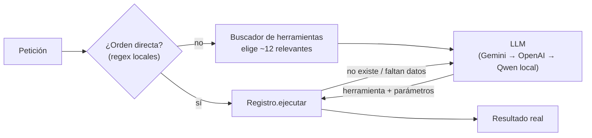

# Conectores de Bark

Bark organiza todo lo que puede hacer en **conectores**, la misma idea que usan los asistentes como Claude: cada conector agrupa las herramientas de un área (red, archivos, música, un servidor MCP…) y dice si está disponible en este equipo. Hoy son **20 conectores y 123 herramientas**, más las que agregues por MCP.

## Cómo decide Bark qué herramienta usar



1. **Enrutador directo.** Las órdenes frecuentes («qué clima hace mañana», «instala Discord», «anota…») se reconocen con expresiones regulares y se ejecutan sin pasar por el modelo: respuesta inmediata incluso sin internet.
2. **Buscador de herramientas.** Un modelo de 3-4B no puede leer 123 descripciones en cada turno. Bark puntúa las herramientas contra lo que pediste (nombre, sinónimos, palabras clave y descripción) y solo le muestra unas 12, más las básicas. Si el modelo no ve la que necesita, puede llamar `buscar_herramientas(consulta)`, igual que la búsqueda de herramientas de Claude.
3. **Registro tolerante.** Lo que el modelo devuelve pasa por `conectores/registro.py`, que corrige sus errores típicos antes de ejecutar nada.

## «Si no lo encuentro, busco lo más parecido»

| Si el modelo o el usuario dice… | Bark hace |
|---|---|
| Una herramienta que no existe (`mandar_whatsap`) | Usa la más parecida o la sugiere y deja que el modelo reintente |
| Un parámetro mal nombrado (`app` en vez de `nombre_app`) | Lo reasigna por parecido y convierte tipos (`"40%"` → `40`) |
| Una ruta que no existe (`Escritorio\bark ai\config`) | Corrige cada carpeta con la real más parecida y avisa qué usó |
| Solo un nombre de archivo (`reporte final`) | Lo busca en Escritorio, Documentos, Descargas, Imágenes… |
| Una app, ventana, red Wi-Fi, servicio, contacto, sitio, moneda o unidad aproximada | Elige la coincidencia clara; si hay empate, pregunta con opciones |

Toda la lógica de parecido está en `conectores/similitud.py` (`mejores`, `elegir`, `resolver_ruta`, `buscar_por_nombre`) y reutiliza la puntuación con la que Bark ya abría apps.

## Seguridad

- Las herramientas marcadas 🔒 (`sensible=True`) **siempre** piden permiso por voz o en pantalla, con la descripción y los parámetros reales.
- WhatsApp y correo **no envían nada**: abren el chat o el borrador y tú pulsas Enviar.
- La terminal bloquea comandos destructivos (`format`, `diskpart`, borrados recursivos de unidades, `iex` de scripts remotos…) aunque des permiso.
- Los atajos que cierran ventanas o la sesión (`alt+f4`, `win+l`) no se envían desde el conector de teclado.
- Notas, pendientes, agenda y contactos se guardan en `bd_memoria/*.json`, en tu PC; esa carpeta no se sube a Git.

## Conectores MCP (como los de Claude)

[MCP](https://modelcontextprotocol.io) es el estándar abierto con el que Claude se conecta a GitHub, Google Drive, Notion, bases de datos y cientos de servicios más. Bark trae su propio cliente MCP (`conectores/mcp.py`, sin dependencias extra), así que **cualquier servidor MCP se vuelve un conector de Bark**:

1. Copia `config/conectores_mcp.example.json` como `config/conectores_mcp.json` (o pulsa **Configurar MCP** en el panel de Conectores).
2. Activa o agrega servidores. Dos transportes:
   - **Local (stdio):** `"comando"` y `"argumentos"`, p. ej. `npx -y @modelcontextprotocol/server-filesystem C:/Users/tú/Documents`.
   - **Remoto (HTTP):** `"url"` y `"encabezados"`, p. ej. el servidor oficial de GitHub con `Authorization: Bearer ${GITHUB_TOKEN}`.
3. Pon los tokens en `.env` y referéncialos como `${VARIABLE}`.
4. Reinicia Bark o di «recarga los conectores».

Cada herramienta remota aparece como `mcp_<servidor>_<herramienta>` y pide permiso salvo que el servidor la marque como de solo lectura (`readOnlyHint`) o la pongas en `"confiables"`. Un servidor que no arranca aparece como no disponible con el motivo, y Bark sigue funcionando.

## Bark instala y crea conectores por sí mismo

No hace falta editar JSON: díselo.

| Dices… | Bark usa |
|---|---|
| «¿Qué conectores puedes instalar?» | `catalogo_conectores()` |
| «Conecta ElevenLabs» / «conéctate a GitHub» | `instalar_conector(nombre)` 🔒 con la receta del catálogo |
| «Agrega el servidor MCP `npx -y @org/servidor` con la clave NOTION_TOKEN» | `agregar_conector_mcp(nombre, comando, url, descripcion, variable_clave)` 🔒 |
| «Quita el conector de GitHub» | `quitar_conector(nombre)` 🔒 |

Catálogo incluido (recetas verificadas con la documentación oficial): **elevenlabs** (`uvx elevenlabs-mcp`, archivado desde agosto de 2026 pero funcional), **github** (remoto), **archivos**, **web** (fetch), **memoria_grafo**, **git** y **hora**. Si una receta necesita una clave, Bark la guarda como `${VARIABLE}` y el campo aparece solo en **⚙ Ajustes › Claves y datos**; nunca pide claves por el chat. Si falta `npx` o `uvx`, dice qué instalar.

## Habilidades (prompts guardados)

Como las *skills* de Claude: instrucciones reutilizables que Bark aplica solo cuando vienen al caso. Dile «cuando te pida un resumen de noticias, dame 3 viñetas y una conclusión; guárdalo como habilidad» y Bark redacta el prompt y lo guarda con `crear_habilidad(nombre, instrucciones, cuando_usar)`. En cada turno, `conectores/habilidades.py` busca las que coinciden con tu petición y las agrega al contexto (también llegan a Gemini Live). Se guardan en `bd_memoria/habilidades.json`; `listar_habilidades`, `ver_habilidad` y `borrar_habilidad` las administran.

## Razonamiento breve

Antes de decidir, el modelo puede escribir un `"plan"` de 1-2 frases dentro del mismo JSON (qué quieres, qué herramientas y en qué orden), y marcar `"continuar": true` para encadenar pasos viendo cada resultado («abre Spotify y pon Daft Punk»). Es un «pensar en voz baja» barato para modelos sin *thinking* (Qwen2.5, GPT-4.1-mini); se apaga solo si el único cerebro es un modelo local que ya piensa (Qwen3, DeepSeek R1). El plan se registra en consola como `[PLAN]` y no se muestra al usuario. Ajustes: `BARK_RAZONAMIENTO=auto|1|0` y `BARK_MAX_PASOS` (por defecto 4).

## Crear un conector nuevo

```python
# conectores/hogar.py
from conectores.registro import REGISTRO, requiere_modulo

REGISTRO.conector("hogar", "Casa inteligente", "Luces y enchufes de la casa.",
                  requisito=requiere_modulo("tinytuya"))   # se marca no disponible si falta


@REGISTRO.herramienta("hogar", "Enciende o apaga una luz por su nombre aproximado",
                      alias=("prender_luz", "apagar_luz"), palabras=("luz", "foco", "prende", "apaga"))
def controlar_luz(nombre: str, encender: bool = True) -> str:
    ...
    return "Prendí la luz de la sala."
```

Después agrega `"hogar"` a `_MODULOS` en `conectores/__init__.py`. La firma de la función se documenta sola para el modelo; usa `sensible=True` si la acción cambia algo importante y `rutas=("ruta",)` si un parámetro debe apuntar a un archivo existente (Bark lo corregirá por parecido).

## Catálogo de herramientas

🔒 = pide permiso antes de ejecutarse. `?` = parámetro opcional.

### Núcleo de Bark (3)

Buscar herramientas, ver conectores y recargar servidores MCP.

| Herramienta | Qué hace |
|---|---|
| `buscar_herramientas(consulta)` | Busca qué herramientas sirven para una tarea cuando ninguna de la lista encaja |
| `listar_conectores()` | Muestra los conectores de Bark, si están disponibles y cuántas herramientas tienen |
| `recargar_conectores_mcp()` | Vuelve a leer config/conectores_mcp.json y reconecta los servidores MCP |

### Aplicaciones (5)

Abrir, buscar y cerrar programas instalados, también apps de la Tienda.

| Herramienta | Qué hace |
|---|---|
| `abrir_aplicacion(nombre_app)` | Abre un programa por su nombre hablado (entiende sinónimos y apps de la Tienda) |
| `buscar_y_abrir_aplicacion(nombre)` | Busca accesos directos en Escritorio e Inicio y abre la coincidencia inequívoca |
| `listar_aplicaciones_instaladas(consulta?, limite?)` | Lista programas instalados; consulta filtra por nombre |
| `listar_juegos_instalados(limite?)` | Lista juegos y launchers instalados |
| `cerrar_aplicacion(nombre_app)` | Cierra una aplicación o proceso activo 🔒 |

### Archivos y carpetas (19)

Explorar, buscar, abrir, crear, mover y comprimir archivos locales.

| Herramienta | Qué hace |
|---|---|
| `abrir_ubicacion(ruta)` | Abre una carpeta o archivo existente sin modificarlo |
| `listar_archivos(ruta?)` | Lista el contenido de una carpeta |
| `crear_carpeta(ruta)` | Crea una carpeta nueva |
| `buscar_archivos_locales(consulta?, fecha?, limite?)` | Busca documentos por nombre y/o fecha (hoy, ayer, dd/mm/aaaa) y numera las opciones |
| `abrir_archivo_encontrado(indice?)` | Abre la opción número N de la última búsqueda de archivos |
| `escribir_archivo(ruta_archivo, contenido)` | Crea o sobrescribe un archivo de texto 🔒 |
| `eliminar_archivo(ruta_archivo)` | Borra un archivo definitivamente 🔒 |
| `crear_carpeta_resultados(nombre_tarea)` | Crea una carpeta Resultados_X en el escritorio para una tarea |
| `buscar_archivo_parecido(nombre, solo_carpetas?, carpeta?)` | Busca archivos o carpetas cuyo nombre se parezca al dicho, en tus carpetas personales |
| `abrir_carpeta(nombre)` | Abre una carpeta por su nombre aunque no digas la ruta completa |
| `info_archivo(ruta)` | Muestra tamaño, tipo y fechas de un archivo o carpeta |
| `archivos_recientes(limite?)` | Archivos modificados más recientemente en tus carpetas personales |
| `copiar_archivo(origen, destino)` | Copia un archivo o carpeta a otro lugar 🔒 |
| `mover_archivo(origen, destino)` | Mueve un archivo o carpeta a otro lugar 🔒 |
| `renombrar_archivo(ruta, nuevo_nombre)` | Cambia el nombre de un archivo o carpeta 🔒 |
| `mover_a_papelera(ruta)` | Manda un archivo o carpeta a la Papelera de reciclaje (se puede recuperar) 🔒 |
| `comprimir_zip(ruta, destino?)` | Comprime un archivo o carpeta en un .zip 🔒 |
| `descomprimir_zip(ruta, destino?)` | Extrae un .zip en una carpeta 🔒 |
| `espacio_en_disco()` | Espacio libre y usado de cada disco |

### Documentos (4)

Leer PDF/Word/TXT, crear Word con formato APA y convertir DOCX↔PDF.

| Herramienta | Qué hace |
|---|---|
| `leer_documento(ruta, max_caracteres?)` | Lee el texto de un .txt, .pdf o .docx |
| `crear_documento_word(ruta_archivo, titulo, contenido, referencias?)` | Crea un .docx con título, contenido y referencias |
| `investigar_y_crear_word(tema, ruta_archivo?)` | Investiga un tema en la web y crea un Word APA con fuentes |
| `convertir_documento(ruta, formato_destino)` | Convierte DOCX a PDF o PDF a DOCX 🔒 |

### Web y navegador (6)

Buscar en internet, leer páginas y abrir sitios.

| Herramienta | Qué hace |
|---|---|
| `buscar_informacion(query, num_resultados?)` | Busca en internet y devuelve resultados breves |
| `extraer_texto_pagina(url, max_caracteres?)` | Extrae el texto de una URL |
| `abrir_en_navegador(url)` | Abre una URL completa en el navegador |
| `cerrar_pestana_navegador()` | Cierra la pestaña activa del navegador (Ctrl+W) |
| `abrir_sitio(nombre)` | Abre un sitio web por su nombre aproximado (YouTube, Classroom, Mercado Libre…) |
| `buscar_en_sitio(consulta, sitio?)` | Busca algo dentro de un sitio: YouTube, Maps, Amazon, Mercado Libre, GitHub, imágenes… |

### Música y multimedia (6)

Spotify, canciones, videos y capturas de pantalla.

| Herramienta | Qué hace |
|---|---|
| `controlar_spotify(accion)` | Controla la reproducción: accion = play_pausa, siguiente o anterior |
| `buscar_y_reproducir_spotify(cancion)` | Busca y reproduce una canción o artista en Spotify |
| `buscar_canciones(consulta, limite?)` | Muestra opciones de canciones para elegir |
| `reproducir_cancion_encontrada(indice?, artista?)` | Reproduce una canción de la última lista por número o artista |
| `descargar_video(url, solo_audio?, carpeta_destino?)` | Descarga un video o solo el audio de YouTube y otros sitios 🔒 |
| `tomar_captura_pantalla(ruta_guardado?)` | Toma una captura de pantalla 🔒 |

### Control del equipo (18)

Volumen, brillo, energía, ventanas, portapapeles, temporizadores y ajustes.

| Herramienta | Qué hace |
|---|---|
| `abrir_configuracion(seccion?)` | Abre una sección de la Configuración de Windows (wifi, bluetooth, sonido…) |
| `controlar_volumen(accion, pasos?)` | Sube, baja o silencia el volumen: accion = subir|bajar|silenciar |
| `fijar_volumen(porcentaje)` | Pone el volumen en un porcentaje exacto |
| `fijar_brillo(porcentaje)` | Pone el brillo de la pantalla en un porcentaje |
| `estado_bateria()` | Nivel y estado de la batería |
| `bloquear_pc()` | Bloquea la sesión |
| `minimizar_todo()` | Minimiza todas las ventanas |
| `apagar_pc(segundos?)` | Apaga el equipo tras unos segundos 🔒 |
| `reiniciar_pc(segundos?)` | Reinicia el equipo tras unos segundos 🔒 |
| `suspender_pc()` | Suspende el equipo 🔒 |
| `cancelar_apagado()` | Cancela un apagado o reinicio programado |
| `listar_ventanas_abiertas()` | Lista las ventanas abiertas |
| `enfocar_ventana(nombre)` | Trae al frente la ventana más parecida al nombre |
| `leer_portapapeles(max_caracteres?)` | Lee el texto del portapapeles |
| `copiar_al_portapapeles(texto)` | Copia un texto al portapapeles |
| `crear_temporizador(minutos, mensaje?)` | Avisa dentro de N minutos (0.5 = 30 s) con un mensaje |
| `listar_temporizadores()` | Lista los temporizadores activos |
| `cancelar_temporizadores()` | Cancela todos los temporizadores |

### Optimización (9)

Diagnóstico de RAM y disco, programas de inicio, temporales y planes de energía.

| Herramienta | Qué hace |
|---|---|
| `diagnosticar_equipo()` | Revisa RAM, disco y procesos sin modificar nada |
| `diagnosticar_ram_avanzado(limite?)` | Procesos que más RAM consumen |
| `liberar_ram_avanzada()` | Libera RAM sin cerrar programas 🔒 |
| `listar_elementos_inicio()` | Programas y tareas que arrancan con Windows |
| `desactivar_elemento_inicio(nombre)` | Desactiva una entrada de inicio sin desinstalar 🔒 |
| `resumen_optimizacion()` | Analiza qué se puede optimizar sin cambiar nada |
| `limpiar_temporales_usuario()` | Limpia archivos temporales del usuario 🔒 |
| `optimizar_pc()` | Optimización completa: RAM, temporales, DNS y recomendaciones 🔒 |
| `plan_de_energia(modo?)` | Muestra o cambia el plan de energía (alto rendimiento, equilibrado, ahorro) 🔒 |

### Información del equipo (4)

Procesador, RAM, gráfica, uso de CPU, procesos y tiempo encendido.

| Herramienta | Qué hace |
|---|---|
| `info_sistema()` | Especificaciones: sistema, procesador, RAM, gráfica y tiempo encendido |
| `tiempo_encendido()` | Cuánto tiempo lleva encendido el equipo |
| `uso_recursos()` | Uso actual de CPU, RAM y disco del sistema |
| `listar_procesos(orden?, limite?)` | Procesos que más consumen; orden = memoria o cpu |

### Servicios y dispositivos (5)

Servicios de Windows, impresoras, audio y memorias USB.

| Herramienta | Qué hace |
|---|---|
| `listar_servicios(filtro?, solo_activos?)` | Lista servicios de Windows; filtro por nombre opcional |
| `controlar_servicio(nombre, accion?)` | Inicia, detiene o reinicia un servicio de Windows (puede requerir administrador) 🔒 |
| `listar_impresoras()` | Impresoras instaladas y cuál es la predeterminada |
| `imprimir_archivo(ruta)` | Imprime un archivo en la impresora predeterminada 🔒 |
| `listar_dispositivos(tipo?)` | Dispositivos de audio, cámaras y USB conectados |

### Red e internet (6)

Conexión, IP local y pública, ping, redes Wi-Fi y dispositivos Bluetooth.

| Herramienta | Qué hace |
|---|---|
| `estado_red()` | Estado de la conexión: internet, Wi-Fi actual e IP local |
| `ip_publica()` | IP pública y ubicación aproximada de tu conexión |
| `hacer_ping(host?, veces?)` | Mide la latencia hacia un sitio o IP |
| `redes_wifi()` | Redes Wi-Fi disponibles con su señal |
| `conectar_wifi(nombre)` | Se conecta a una red Wi-Fi guardada; acepta el nombre aproximado |
| `dispositivos_bluetooth()` | Dispositivos Bluetooth emparejados |

### Instalar programas (winget) (5)

Busca, instala, actualiza y desinstala programas con el gestor oficial de Windows.

| Herramienta | Qué hace |
|---|---|
| `buscar_programa(nombre)` | Busca programas disponibles para instalar |
| `instalar_programa(nombre)` | Instala un programa por su nombre aproximado o Id de winget 🔒 |
| `listar_actualizaciones()` | Lista programas con actualizaciones pendientes |
| `actualizar_programas(nombre?)` | Actualiza un programa, o todos si nombre está vacío 🔒 |
| `desinstalar_programa(nombre)` | Desinstala un programa por su nombre aproximado 🔒 |

### Terminal (1)

Ejecuta comandos de PowerShell con tu permiso y bloquea los destructivos.

| Herramienta | Qué hace |
|---|---|
| `ejecutar_comando(comando, carpeta?)` | Ejecuta un comando de PowerShell y devuelve su salida 🔒 |

### Notas, pendientes y agenda (11)

Notas rápidas, lista de pendientes, eventos y recordatorios; todo guardado en tu PC.

| Herramienta | Qué hace |
|---|---|
| `recordatorio_a_las(hora, mensaje?)` | Te avisa a una hora concreta del día (ej. «17:30», «5 de la tarde») |
| `crear_nota(texto, titulo?)` | Guarda una nota rápida |
| `listar_notas(consulta?)` | Muestra tus notas; consulta filtra por parecido |
| `borrar_nota(nota)` | Borra la nota que más se parezca al texto dado 🔒 |
| `agregar_pendiente(tarea, fecha?)` | Agrega una tarea a tu lista de pendientes |
| `listar_pendientes(incluir_hechos?)` | Muestra tus pendientes |
| `completar_pendiente(tarea)` | Marca como hecho el pendiente más parecido |
| `agregar_evento(titulo, fecha?, hora?)` | Agenda un evento (fecha: hoy, mañana, el viernes, 25/12…; hora opcional) |
| `eventos_de(fecha?)` | Eventos de un día (hoy por defecto) |
| `proximos_eventos(dias?)` | Eventos de los próximos días |
| `borrar_evento(titulo)` | Borra el evento más parecido al título 🔒 |

### Contactos, WhatsApp y correo (4)

Agenda local de contactos; prepara mensajes de WhatsApp y correos para que tú los envíes.

| Herramienta | Qué hace |
|---|---|
| `guardar_contacto(nombre, telefono?, correo?, alias?)` | Guarda o actualiza un contacto con teléfono y/o correo |
| `buscar_contacto(nombre?)` | Busca un contacto por nombre o apodo aproximado |
| `enviar_whatsapp(contacto, mensaje?)` | Abre WhatsApp con el chat del contacto y el mensaje escrito (tú lo envías) |
| `redactar_correo(destinatario, asunto?, cuerpo?)` | Abre tu programa de correo con un correo listo para revisar y enviar |

### Clima, divisas y saber (5)

Clima (Open-Meteo), tipo de cambio, resúmenes de Wikipedia, noticias y conversión de unidades.

| Herramienta | Qué hace |
|---|---|
| `clima(ciudad?, dia?)` | Clima actual y pronóstico de una ciudad (dia: hoy, mañana o pasado mañana) |
| `tipo_de_cambio(de?, a?, cantidad?)` | Tipo de cambio entre monedas (dólar, euro, peso…) |
| `definir(tema)` | Resumen de Wikipedia sobre un tema; corrige el título si está mal escrito |
| `noticias(tema?, limite?)` | Titulares recientes de Google Noticias (México); tema opcional |
| `convertir_unidades(cantidad, de, a)` | Convierte cantidades entre unidades (km, millas, libras, °F, GB, tazas…) |

### Git y VS Code (3)

Estado e historial de repositorios Git y abrir carpetas en Visual Studio Code.

| Herramienta | Qué hace |
|---|---|
| `estado_git(ruta?)` | Rama, cambios sin guardar y sincronía de un repositorio Git |
| `ultimos_commits(ruta?, cantidad?)` | Últimos commits de un repositorio |
| `abrir_en_vscode(ruta)` | Abre una carpeta o archivo en Visual Studio Code |

### Teclado y atajos (2)

Escribe texto y pulsa atajos (guardar, copiar, nueva pestaña…) en la ventana activa.

| Herramienta | Qué hace |
|---|---|
| `escribir_texto(texto)` | Escribe un texto en la ventana activa como si lo tecleara 🔒 |
| `presionar_atajo(atajo)` | Pulsa un atajo por nombre (guardar, copiar, nueva pestaña…) o combinación (ctrl+shift+t) |

### Ingeniería de software (5)

Explorar y editar código con reemplazos exactos y verificar Python.

| Herramienta | Qué hace |
|---|---|
| `explorar_proyecto(ruta?, profundidad?)` | Lista la estructura del proyecto antes de editar |
| `leer_archivo_codigo(ruta, max_caracteres?)` | Lee un archivo de código o configuración del proyecto |
| `reemplazar_texto_archivo(ruta, buscar, reemplazar)` | Reemplaza un bloque exacto una sola vez 🔒 |
| `verificar_archivo_python(ruta)` | Comprueba la sintaxis de un archivo Python |
| `ejecutar_script_python(ruta_script, carpeta_sandbox?)` | Ejecuta un script en la carpeta sandbox 🔒 |

### Memoria personal (2)

Recuerdos y conversaciones guardadas localmente en SQLite.

| Herramienta | Qué hace |
|---|---|
| `consultar_memoria(consulta?)` | Consulta recuerdos personales guardados localmente |
| `consultar_biblioteca(periodo?, consulta?)` | Conversaciones guardadas; periodo = hoy, semana o todo |
